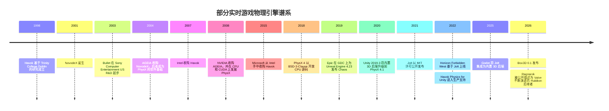
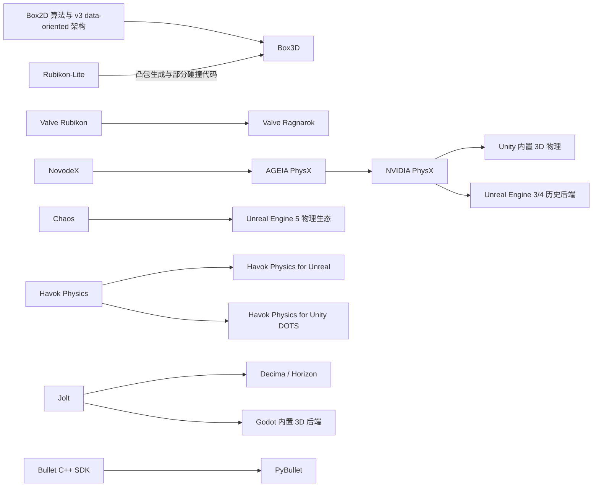
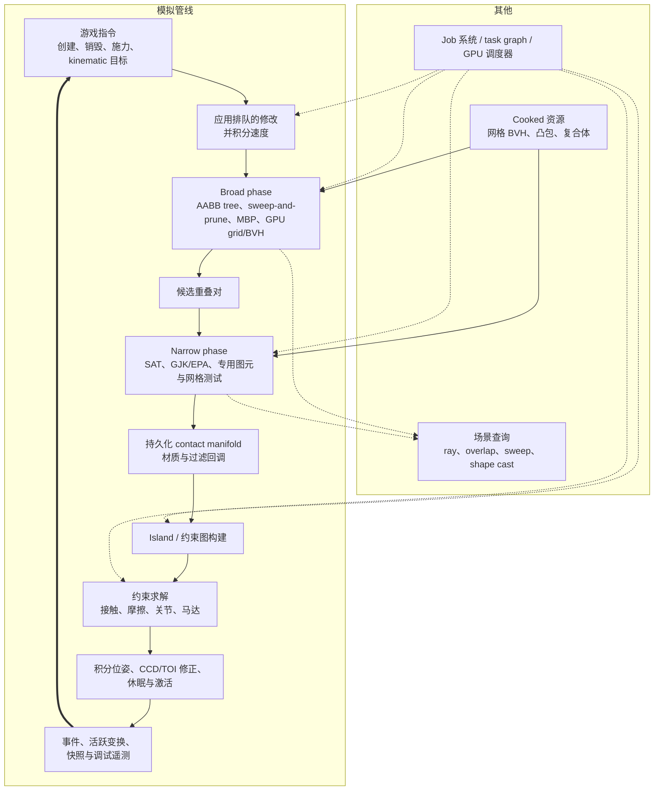
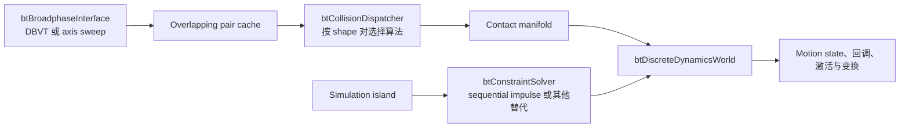

> 本文面向正在评估实时/联网游戏物理方案的游戏引擎程序员和技术总监。
> 由 GPT-5.6 sol-xhigh 撰写，经人工审阅。

具体来说，本文比较以下七个支持 3D 的物理系统：

1. Jolt Physics
2. Box3D
3. NVIDIA PhysX 4.1
4. Havok Physics
5. Unreal Engine 中的 Chaos Physics
6. Bullet 3 / Bullet Physics SDK
7. Valve 的 Ragnarok / Rubikon 系列

关注点是实时游戏开发：除了基本的刚体动力学、碰撞查询、角色、载具、布娃娃（ragdoll），还关注在物理破坏、大世界支持、确定性仿真这样的高级特性。

“确定性”（deterministic）分为三个层级：

- **单个可执行文件/单机可重复：** 在控制好执行顺序和浮点状态的前提下，相同输入得到相同输出。
- **跨构建或跨平台确定性：** 在文档规定的约束下，不同编译器、操作系统或 CPU 架构得到逐位一致（bit-identical）或按约定一致的结果。
- **可用于联网：** 整个应用还需要具备确定性的输入顺序、分配/ID 行为、回调、玩法数学、序列化、时间步进以及 rollback/状态历史。仅有一个确定性的物理库并不能保证这一点。

## 结论摘要

不存在通用的“最快物理引擎”。实际的赢家取决于场景拓扑、求解器质量目标、CCD 策略、simulation island 的数量和大小、查询负载、流式加载模式、线程预算、目标硬件，以及游戏引擎本身已经提供了多少编辑器/网络/工具方面的工作。

简短结论如下：

- **Jolt Physics** 生产级。适合重视多核扩展、大世界、确定性模拟的项目。它有《Horizon Forbidden West》和《Death Stranding 2》的有力生产验证，并且已成为 Godot 4.6 新项目的默认 3D 后端。
- **Box3D** 仅供学习。适合以 C 为主、data-oriented 的引擎，权威服务器模拟，体素/流式世界为特点的实验项目。它提供很多现代功能，但它目前仅为 0.1 版本。
- **PhysX 4.1** 生产级。它成熟、功能丰富，性能优秀，在公开平台上采用宽松许可，并同时具备 CPU 和可选的 CUDA 刚体路径。不过新的独立项目应评估 PhysX 5，而不是从 4.1 起步，除非需求就是兼容 Unity 时代的行为或已有的 4.x 集成。
- **Havok Physics** 生产级。它的差异化在于生产支持、广泛的平台覆盖、稳健的边界情况处理、跨平台确定性、成熟的调试工具，以及持续维护的 Unreal 集成。与开源引擎相比，公开的架构细节和可复现的 benchmark 有限，许可/评估本身就是一项重要的采购决策。
- **Chaos Physics** 生产级。它的优势在于与 Geometry Collection、破坏编辑、Dataflow、Niagara、联网/重模拟、布料、肌肉（flesh）、毛发、载具以及 Unreal 编辑器的深度集成。
- **Bullet 3** 试验级。仍是一个灵活、宽松许可、可移植的工具箱，覆盖游戏、VFX、机器人和机器学习。它模块化的碰撞/动力学设计和 PyBullet 生态是主要优势。生产用的 C++ 路径基本仍是 Bullet 2 风格的 CPU 栈；仓库中的 OpenCL “Bullet 3” 路径明确标注为实验性。对于新的高物体数量游戏运行时，应仔细与 Jolt 和 Box3D 做 benchmark，而不是因为它历史上的普及度就认为它具有当前最好的 CPU 扩展性。
- **Ragnarok** 仅供了解。是 Erin Catto 在 2026 年 6 月公开披露的 Valve 内部 Rubikon 后继/演进版本。它与物理引擎的历史和 Valve 未来的技术相关，但没有公开。它不是外部可采用的候选。


## 历史与谱系

### 时间线


关于归属和起源的关键来源包括：NVIDIA 关于 [NovodeX 始于 2001 年并经两次收购成为 PhysX](https://developer.nvidia.com/blog/open-source-simulation-expands-with-nvidia-physx-5-release/) 的说明、Intel 的 [2007 年 Havok 收购公告](https://www.intel.com/pressroom/archive/releases/2007/20070914corp.htm)、Microsoft 的 [2015 年 Havok 收购公告](https://blogs.microsoft.com/blog/2015/10/02/havok-to-join-microsoft/)、Epic/Intel 的 [GDC 2019 Chaos 介绍](https://www.intel.com/content/dam/develop/external/us/en/documents/unreal-engines-new-chaos-physics-system-screams-with-in-depth-intel-cpu-optimizations.pdf)、Guerrilla 的 [Jolt 生产实践演讲](https://www.guerrilla-games.com/read/architecting-jolt-physics-for-horizon-forbidden-west)，以及 Erin Catto 的 [2026 年 Box3D/Rubikon/Ragnarok 历史](https://box2d.org/posts/2026/06/announcing-box3d/)。

### 谱系图



## 通用架构模型

大多数实时刚体引擎实现的都是同一条管线的变体。它们真正的差异在于数据归属、并发、算法、求解策略、缓存设计，以及管线与游戏引擎耦合的紧密程度。



对评估的重要启示：

- 在流式加载/开放世界游戏中，即使实际碰撞的物体很少，broad phase 也可能成为主要开销。
- 当内容包含复杂凸包、三角网格、高度场或高速薄结构时，narrow phase 的选择很重要。
- 不同引擎之间的求解器迭代次数不可互换。“四次迭代”可能代表不同的工作量和不同的质量。
- 并行性能取决于可用的独立工作量。成千上万的孤立物体和大量小 island 的并行方式，与一个巨大的布娃娃/约束 island 截然不同。
- CCD 不是一个单一开关：speculative contact、扫掠球近似、全形状 linear cast 以及多遍 time-of-impact 求解器，各自有不同的开销和失效模式。
- 场景查询通常服务于玩法、AI、相机、音频和导航；它们的开销和并发模型可能比刚体求解时间更重要。
- 集成开销是架构层面的。如果每帧都通过抽象层拷贝刚体、在主线程上串行化回调，或者不必要地重建 cooked 数据，那么再快的 SDK 也可能输掉。

## 一览对比

| 引擎 | 可得性 / 许可 | 主要设计重心 | 核心运行时风格 | 并行 / 加速策略 | 确定性承诺 | 当前采用态势 |
|---|---|---|---|---|---|---|
| Jolt 5.6.x 源码快照 | MIT，开源 | CPU 多核游戏和 VR；并发引擎访问 | C++17 retained world，handle/ID，显式 job 和临时分配器 | 注重锁的/lock-free 结构、job、SIMD；CPU 刚体；独立的 GPU 毛发功能 | 设计上同次运行确定性；可选跨平台构建，有文档说明的注意事项，引用开销约 8% | 自研引擎的强力默认选项；经过生产验证 |
| Box3D 0.1 | MIT，开源 | 以 C 为主的 Box2D 3D 姊妹版；大规模堆叠、服务器世界、回放 | 可移植 C17，不透明的分代 ID，data-oriented 数组 | Graph coloring、wide-SIMD 接触块、多线程钩子或内置调度器；SSE2/NEON/Wasm SIMD | 跨平台确定性；禁用 FMA contraction；录制/回放 | 技术上很有前景，但尚早期且仍在完善 |
| PhysX 4.1.2 | 公开源码 BSD-3-Clause；主机代码另有条款/NDA | 从移动 CPU 到多核 CPU/CUDA GPU 的可扩展中间件 | C++ scene/actor/shape retained API、cooking、扩展库 | Task dispatcher、SIMD、ABP/SAP/MBP/GPU broad phase、可选 CUDA 刚体管线 | 增强的本地确定性模式；无通用的跨平台逐位保证 | 成熟的遗留版本；与 Unity 2022 及已有 4.x 集成相关 |
| Havok Physics 2025.x | 商业专有 SDK | 有支持、稳健、跨平台的 AAA 中间件 | C++ SDK 加工具和引擎集成 | 专有多核优化；详细内部实现/benchmark 大多仅对客户开放 | 厂商保证的跨平台确定性 SDK，前提是集成本身也是确定性的 | 当支持、平台认证和稳健性值得这笔费用时最佳 |
| UE 5.x 中的 Chaos | Unreal license 下的 Unreal Engine 源码 | 深度 Unreal 原生的模拟与内容工作流 | UE 模块、game/physics 线程 proxy、Task Graph、编辑器资源 | Task Graph、异步/专用物理线程、ISPC/SIMD CPU 内核；特定功能的 GPU 路径 | 联网使用复制、预测和重模拟；不要假设跨平台 lockstep | Unreal 内的自然选择，尤其是破坏和编辑 |
| Bullet 3.27 源码快照 | zlib，开源 | 广泛可复用的碰撞/多物理工具箱 | 模块化的 C++ collision world 和 dynamics world；可选组件 | CPU SIMD 和可选的多线程分发/求解器；实验性 OpenCL 管线 | 通常仅在受控配置下可重复；无广泛的跨平台保证 | 成熟灵活；在纯游戏运行时之外生态最强 |
| Ragnarok | 闭源，Valve 内部 | 未来的 Valve/Source 物理，Rubikon 的演进 | 未公开 | 公开描述仅为具有与 Box3D 类似的优化 | 未公开 | 观察项，不是可采用的中间件 |

## 1. Jolt Physics

### 起源与理念

Jolt 最初是 Jorrit Rouwé 的个人学习项目，后来在 Guerrilla 的生产问题中成型。关键关注点不仅是让 `PhysicsSystem::Update` 跑得快，而是允许多线程游戏引擎在查询、流式加载、添加和移除物理数据时，不把物理世界变成一个全局同步瓶颈。

Guerrilla 报告称，《Horizon Forbidden West》从一个商业引擎切换到 Jolt 后，内存和可执行文件体积都减小了，同时模拟频率翻倍且 CPU 时间更少。相关的架构工作强调 lock-free 的 broad phase 和 lock-free 的 simulation island 构建。参见 [Guerrilla 的 GDC 2022 总结](https://www.guerrilla-games.com/read/architecting-jolt-physics-for-horizon-forbidden-west) 和 [带演讲者备注的幻灯片](https://jrouwe.nl/architectingjolt/ArchitectingJoltPhysics_Rouwe_Jorrit_Notes.pdf)。

上游 [README](https://github.com/jrouwe/JoltPhysics) 列出了四个与游戏尤其相关的设计优先级：

- 并发的碰撞查询和世界修改，并具有明确定义的前后可见性。
- 后台批量构建和低影响插入，以支持流式加载。
- 显式的激活行为，使内容变化不会意外唤醒大片邻近区域。
- 确定性模拟，包括可选的跨平台确定性构建。

### 架构

Jolt 使用常规的 `world/body/shape/constraint` 模型，但把归属和并发显式化：

- `PhysicsSystem` 拥有刚体、约束、broad phase、接触管理、island 和步进管线。
- 刚体通过 `BodyInterface` 访问；ID 将公开的生命周期引用与内部存储和加锁分离开。
- Shape 是不可变且引用计数的，便于共享和安全的并发使用。静态、复合、网格和高度场 shape 可以在插入前预先 cook。
- Object layer 和 broad-phase layer 让集成层在 narrow phase 工作之前编码粗粒度的碰撞策略。
- 应用程序向 `PhysicsSystem::Update` 提供 `JobSystem` 和临时分配器，让物理任务参与引擎自己的调度器，而不是拥有一个不透明的线程池。
- Broad phase 支持并发查询和更新。Narrow phase 的 collector 让分配和提前退出策略显式化。
- 活跃刚体构成 simulation island。大型 island 可以拆分成并行批次；当相对变换没有实质变化时，接触缓存可避免重复 narrow phase 工作。
- 默认求解器是迭代式冲量/约束求解器，分别控制速度和位置迭代次数。约束优先级可以偏向更有影响力的约束，比如靠近布娃娃根节点的关节。

完整的上游参考资料是 [Architecture of Jolt Physics](https://jrouwe.github.io/JoltPhysics/)。


### 性能

官方的 [Jolt 多核研究](https://jrouwe.nl/jolt/JoltPhysicsMulticoreScaling.pdf) 特别有价值，因为它移植的凸体对网格场景包含了 Jolt 1.1、PhysX 4.1 和 Bullet 3.21，并公开了求解器和 CCD 设置。

- 在 3,680 个刚体的布娃娃场景中，在所引用的 Intel EC2 机器上，Jolt 在 8 线程时达到单线程速率的 **4.9×**，16 线程时达到 **5.7×**。
- 超过约 16 核后，由于内存带宽和接触缓存原子操作成为瓶颈，扩展趋于平缓。
- 在移植的凸体对网格场景中，PhysX 在测试笔记本上有更好的单线程性能，而 Jolt 扩展得更好；论文结论是对于这个简单场景，Jolt 达到了相近的整体性能。
- 作者明确警告，PhysX 会根据场景规模限制线程数，并且每个引擎都必须在目标场景上做性能分析。

这项研究是架构扩展性的证据，而不是一张永恒的排行榜：版本已经很旧，负载是合成的，而且当前的 Jolt 已有大幅演进。

### 确定性、平台与集成

可选的 `CROSS_PLATFORM_DETERMINISTIC` 构建在文档中约 **慢 8%**，并在 MSVC/Clang/GCC/Emscripten、Windows/macOS/Linux、32/64 位、x86、ARM、RISC-V、PowerPC、LoongArch 和 Wasm 上测试过。**这一保证有边界**：在多线程下，broad-phase 查询顺序、监听器回调顺序和活跃刚体顺序可能变化，必须由应用程序排序或过滤。权威的注意事项见 [Jolt 的确定性模拟文档](https://jrouwe.github.io/JoltPhysics/#deterministic-simulation)。

官方列出的目标平台包括 Windows x86/x64/ARM64；x86、ARM、RISC-V、LoongArch 和 PowerPC 上的 Linux；FreeBSD；Android；macOS；iOS；MinGW；通过 JoltPhysics.js 的 WebAssembly；以及一个受 NDA 约束的主机平台。x86 最低要求 SSE2，可选 SSE4/AVX/AVX2/AVX-512；ARM64 使用 NEON。参见 [上游平台矩阵](https://github.com/jrouwe/JoltPhysics#supported-platforms)。

值得注意的集成包括 Decima/Guerrilla、Godot、社区的 Source 引擎替换工作以及 Unreal 插件。Godot 在 4.4 中将 Jolt 加入为可选的内置后端；到 [Godot 4.6 文档](https://docs.godotengine.org/en/4.6/tutorials/physics/using_jolt_physics.html) 时，新项目默认使用它。

### 最佳适用场景与注意事项

最佳适用：有显著的流式加载、查询并发、大世界、高刚体数量或确定性回放需求的自研 CPU 导向 3D 引擎。

注意事项：生产集成仍需要资源 cooking/版本管理、编辑器表示、性能分析 UI、对玩法安全的事件顺序、rollback 策略和平台认证。Jolt 丰富的特性列表并不会自动复刻 Unity、Unreal 或遗留引擎抽象层的语义。

## 2. Box3D

### 起源与理念

Box3D 由 Erin Catto 于 2026-06-30 作为面向游戏的 3D 物理引擎发布。它源自一个实际的游戏问题，而不是对 Box2D 的抽象移植：

1. Catto 的《The Legend of California》需要可靠的快速倒下的树木、服务器端模拟、能处理数十万实体的 broad phase、运行时体素碰撞构建，以及对包含数万个碰撞网格的据点进行高效流式加载。
2. Dirk Gregorius 提供了“Rubikon-Lite”，即 Valve Rubikon 引擎的一个个人版本。Catto 将其集成进 Unreal，随后逐步用源自 Box2D v3 的设计替换了大部分 API、数据结构和算法，以让他的 2D 和 3D 工作保持一致。
3. 当前的 Box3D 保留了部分 Rubikon-Lite 的凸包生成和碰撞代码；其余部分源自 Box2D 或是 Box3D 的新工作。

这段历史以及对 Ragnarok 的首次公开描述见 [Announcing Box3D](https://box2d.org/posts/2026/06/announcing-box3d/)。

其理念明显是 Box2D v3 式的：可移植的 C、不透明的分代 ID 而非暴露指针、紧凑的 data-oriented 存储、子步进的“Soft Step”求解器、graph coloring、wide SIMD、显式事件、确定性，以及一个小巧可嵌入的核心。

### 架构

[Box3D 0.1 手册](https://box2d.org/documentation3d/) 描述了一个由刚体、附着的 shape、生成的接触和用户创建的关节组成的世界。在内部：

- 公开的 C17 API 返回带分代检查的不透明 ID。定义（definition）被拷贝进内部结构，这使 API 保持稳定，并让引擎可以独立组织存储。
- Broad phase 使用动态包围体树（dynamic bounding-volume tree）。公开的 dynamic-tree API 也可用于游戏专用的空间索引。
- 凸体碰撞主要使用分离轴测试（Separating Axis Test，SAT），而非仅依赖 GJK/EPA。Catto 认为 SAT 无需碰撞边距（collision margin）就能产生有用的分离特征，并且最近为复杂凸包的边测试加入了 SIMD 优化；参见 [SIMD for Collision](https://box2d.org/posts/2026/07/simd-for-collision/)。
- 连续碰撞结合了 speculative contact 与 time-of-impact 处理，覆盖快速平移和旋转。
- Soft Step 求解器将一个游戏步拆分为多个子步。手册推荐以 60 Hz 加四个子步作为起点，让约束每帧有四次响应机会，而不必让整个游戏循环跑在 240 Hz。
- 约束图被着色（graph coloring），使互不冲突的接触和关节可以并行处理。“Wide SIMD”同时求解多个独立的接触点；worker 调度可以由宿主提供，也可以由可选的内置调度器处理。
- 休眠刚体被组织成 solver set/island。Baked compound 将大量静态集合合并为一个紧凑的单一 shape，解决流式加载和每物体开销问题。
- 位置可以使用双精度，而大部分局部数学仍以 float 为主。当前的 CMake 选项是 `BOX3D_DOUBLE_PRECISION`。
- 录制、回放、世界快照、事件流和确定性数学是一等公民，而不是事后补充。


### 性能

Box3D 包含 benchmark 源码和 CSV 结果，并发布了 [Box3D benchmark 仪表盘](https://box2d.org/files/benchmarks_3d.html)。仓库中签入的 AMD Ryzen 9 7950X SSE2 结果在一个 CCD 上使用 1 到 8 个线程。对于高度并行的负载，当前 CSV 显示：

| 内置负载 | 单线程总耗时 | 8 线程总耗时 | 实测加速比 |
|---|---:|---:|---:|
| Convex pile | 17,336.6 ms | 2,410.11 ms | 7.19× |
| Joint grid | 1,586.48 ms | 214.504 ms | 7.40× |
| Junkyard | 20,044.1 ms | 2,970.84 ms | 6.75× |
| Large pyramid | 2,071.23 ms | 333.042 ms | 6.22× |
| Many pyramids | 2,331.14 ms | 316.039 ms | 7.38× |
| Rain | 2,434.57 ms | 444.147 ms | 5.48× |

`large_world` 这个微型负载在 worker 增多时反而变慢（单线程 10.938 ms，八线程 14.7126 ms），这提醒我们：当工作量太小或划分不佳时，调度开销会压过并行收益。这些数字展示的是 Box3D 内部的扩展性；并没有在模拟质量或速度上与其他引擎比较。

### 确定性、平台与集成

Box3D 宣称跨平台确定性，并在支持的编译器路径中禁用浮点 contraction/FMA，以免标量/SIMD 目标悄然产生分歧。录制和回放使确定性变得可测试。集成层仍需维持稳定的指令和事件顺序。

库和示例在 Windows、Linux 和 macOS 上有文档说明。核心可通过 Emscripten 构建到 Web。SIMD 路径覆盖 SSE2 和 NEON，Wasm SIMD 经由 Emscripten 映射；SIMD 可以禁用。库需要 C17 编译器，示例需要 C++20。核心求解器不需要也不使用 GPU 运行时。

发布公告列出的早期用户有《The Legend of California》、Facepunch 的 s&box、Esoterica，以及 Glenn Fiedler 的千人太空游戏项目。第一个项目通过自定义的 ECS/脚本/动画栈将 Box3D 集成进 Unreal，这有力证明了替换是可行的，但同时也说明这是一项可观的引擎工作。


## 3. NVIDIA PhysX 4.1

### 起源与理念

PhysX 源自 Adam Moravanszky 于 2001 年开始的 NovodeX 引擎，先被 AGEIA 收购，随后在 2008 年随 AGEIA 一起被 NVIDIA 收购。它从专用物理硬件的愿景演变为一个可移植的 CPU SDK 加可选的 CUDA 加速。NVIDIA 在 2018 年以 BSD-3-Clause 开放了 PhysX 4 的 CPU 源码。参见 [NVIDIA 的谱系概述](https://developer.nvidia.com/blog/open-source-simulation-expands-with-nvidia-physx-5-release/) 和 [PhysX 4 开源公告](https://developer.nvidia.com/blog/announcing-physx-sdk-4-0-an-open-source-physics-engine/)。

它的设计目标是广泛的中间件可扩展性：同一套高层 scene/actor/shape API 可以服务移动 CPU、多核桌面/主机 CPU 以及支持 CUDA 的 GPU，并为角色、载具、cooking、序列化和可视化调试提供专门的扩展。

### 架构

PhysX 使用 retained-mode 的对象层级：

- `PxFoundation` 负责分配/错误服务；`PxPhysics` 创建材质、shape、actor、网格和场景。
- 一个 `PxScene` 是一个独立的模拟世界。静态和动态 actor 拥有或共享 `PxShape` 对象；不同场景中的 actor 不会交互。
- Cooking 将三角网格、凸网格和高度场转换为运行时格式。保持 cooking 显式化，有利于离线管线和平台相关的兼容性决策。
- Broad phase 可选 sweep-and-prune（SAP）、multi-box pruning（MBP）、automatic box pruning（ABP，4.x 中新增且为默认），以及启用 CUDA 动力学时的 GPU broad phase。
- Narrow phase 使用专门的图元/凸体/网格算法和持久化 contact manifold。过滤可以拒绝碰撞对，或请求接触、trigger、CCD 和回调。
- 场景构建 island，并通过 CPU dispatcher/task graph 划分工作。`simulate()` 启动工作，`fetchResults()` 进行同步并暴露完成后的状态。应用可以通过高级 API 更显式地拆分碰撞和求解阶段。
- 传统的 projected Gauss-Seidel（PGS）求解器仍然可用。PhysX 4 新增了 Temporal Gauss-Seidel（TGS），它在迭代过程中使用更新后的相对运动重新计算约束，改善了关节/articulation 的收敛性。
- Reduced-coordinate articulation 以低漂移和真实的驱动/逆动力学来建模连杆树，对机械和机器人尤其有用。
- “Immediate mode” 暴露了更底层的接触/约束构建与求解，供需要不同于 `PxScene` 归属模型的应用使用。
- GPU 刚体可以把 broad phase、接触生成、shape/刚体管理和约束求解移到 CUDA 上。不支持的几何/接触情况可以回退，但 GPU 求解器仍会处理响应对，并且需要预分配缓冲区。

签出的源码树中包含完整的 [PhysX 4.1 模拟指南](https://github.com/NVIDIAGameWorks/PhysX/blob/4.1/physx/documentation/PhysXGuide/Manual/Simulation.html)、[线程指南](https://github.com/NVIDIAGameWorks/PhysX/blob/4.1/physx/documentation/PhysXGuide/Manual/Threading.html)、[GPU 刚体指南](https://github.com/NVIDIAGameWorks/PhysX/blob/4.1/physx/documentation/PhysXGuide/Manual/GPURigidBodies.html) 和 [最佳实践指南](https://github.com/NVIDIAGameWorks/PhysX/blob/4.1/physx/documentation/PhysXGuide/Manual/BestPractices.html)。

### 4.1 的重要特性

[4.1 发布说明](https://github.com/NVIDIAGameWorks/PhysX/blob/4.1/physx/release_notes.html) 重点列出了：

- TGS 求解器和 reduced-coordinate articulation。
- ABP broad phase，以及针对包含大量 shape 的 actor 优化的 BVH 结构。
- CPU 和 GPU 刚体、GPU broad phase、GPU articulation 加速、PCM 接触、CCD、场景查询、aggregate、关节、原点平移（origin shifting）、序列化、PVD 和性能分析。
- 角色控制器和载具 SDK 扩展。
- 可选的扭转摩擦，以及改进的以 actor 为中心的查询/cooking。

PhysX 4 移除了旧的核心粒子和布料功能。NVIDIA 的 Blast、NvCloth/APEX 时代的系统、FleX，以及后来 PhysX 5 的可变形体/粒子功能，属于独立的产品或不同代际；不要把 PhysX 5 的完整特性集归到 4.1 名下。

### 与 Unity 2022 LTS 的关系

Unity 的 [2022.3 手册](https://docs.unity3d.com/cn/2022.3/Manual/PhysicsOverview.html) 指出内置 3D 物理是对 NVIDIA PhysX 的集成。Unity 在 2019.3 将该集成升级到 PhysX 4.1，开放了快速 midphase、automatic box pruning、TGS 选择和网格烘焙；参见 [Unity 2019.3 发布说明](https://unity.com/releases/editor/whats-new/2019.3.0)。

对于 Unity 2022 LTS，这意味着：

- `Rigidbody`、`Collider`、`Joint`、`ArticulationBody`、`PhysicsScene`、查询和 Physics Profiler 是围绕 PhysX 行为的 Unity 侧封装和工作流。
- 公开的 NVIDIA 4.1.2 源码树对于架构学习、bug 排查和兼容的原生工具很有价值，但它不能直接替换 Unity 私有的集成层，也不能保证构建参数/补丁完全一致。
- Unity 内置的 PhysX 路径不同于 Unity Physics 和 Havok Physics for Unity，后两者是 DOTS/ECS 包。
- 用 Jolt/Box3D/Bullet 替换 Unity 的后端，需要一个原生插件，外加变换同步、cooking/导入、碰撞层、回调、角色/关节对等、序列化/编辑器工具、各平台二进制文件，并且很可能需要重新调校玩法行为。

### 性能与硬件

PhysX 在 CPU 上有 SIMD 加速和多线程。Jolt 的对比发现，在其简单的凸体对网格测试中 PhysX 单线程速度更强，但该测试中扩展性较弱；它也指出 PhysX 会根据场景规模调度线程，因此更大的场景可能扩展得超过所示结果。

4.1 发布说明列出的公开目标平台为 Windows、Linux、macOS、iOS 和 Android。主机代码不在 GitHub 中，受平台 NDA/条款约束。CUDA 刚体在 Windows 和 Linux 上搭配兼容的 NVIDIA GPU/驱动可用；4.1 的矩阵引用的是 CUDA 10 和 compute architecture 3.0 时代的要求。CPU 版 PhysX 仍然跨厂商，是常规的可移植性基线。

### 确定性、生命周期与最佳适用场景

`PxSceneFlag::eENABLE_ENHANCED_DETERMINISM` 会以性能为代价，减少无关 island 插入/移除带来的变化。这并不是跨操作系统、编译器、CPU 和 GPU 逐位等价的广泛承诺。GPU 执行还会带来额外的顺序和硬件问题。网络 rollback 应把 PhysX 4 的状态捕获/重模拟视为应用自身的责任。

最佳适用：维护和理解 Unity 2022/较老的自研引擎集成、需要 4.x 兼容性的成熟 C++ 中间件需求，或者遗留分支的能力和 API 已经深度嵌入的 CPU/CUDA 模拟。

注意：仓库 README 将 4.1 标为遗留版本，并引导新项目使用 PhysX 5。在 4.1 上开始一个全新引擎，会产生本可避免的迁移债务。

## 4. Havok Physics

### 起源与理念

Havok 于 1998 年基于 Trinity College 的计算机图形学研究在都柏林成立。Intel 在 2007 年收购了它；Microsoft 在 2015 年从 Intel 手中收购它，并继续广泛授权。Microsoft 的收购公告当时已提到，在包括 Activision、EA、Ubisoft、Nintendo、Sony 和 Microsoft 在内的合作方中有超过 600 款游戏使用它。

Havok 的核心理念是生产上的可预测性：在异常内容下行为稳健、帧开销稳定、跨平台确定性输出、深度的平台优化、成熟的可视化调试，以及直接的工程支持。它是一个商业 SDK，而不是一个透明的研究/代码参考。

### 架构与特性

公开的产品资料描述了一个为专有引擎集成而构建的 C++ SDK，具备：

- 动态刚体、连续碰撞、丰富的 shape、约束、布娃娃、角色控制器、高性能查询、大世界支持、运行时 shape 变更和几何处理。
- 稳健的迭代约束求解器，外加针对困难关节系统的直接求解器（direct solver）。
- LOD 碰撞 shape 和工具，旨在让开销在物体和地形规模变化时保持可预测。
- Physics Particles：面向大量特效物体的低开销固体模拟，质量取舍可控。
- Visual Debugger 的捕获/查看器，以及高开销物体的热力图。
- 用于自定义接触行为和从无效状态恢复的 modifier 和回调。

Havok Cloth 和 Havok Navigation 是独立产品。在把广义的“Havok 套件”和单个开源刚体库对比时，产品边界很重要。

最好的公开概述是 [Havok Physics 产品页](https://www.havok.com/havok-physics/)、[2025 产品说明书](https://www.havok.com/wp-content/uploads/2025/03/havokphysics-productsheet.pdf) 和 [2025.2 发布亮点](https://www.havok.com/blog/havok-sdk-2025-2-release-highlights/)。关于 broad phase、接触生成、内存布局和求解器实现的详细文档通常是客户资料；任何超出公开承诺范围的架构比较都应标注为推断。

### 性能与确定性

Havok 宣传自己是最快、最稳健的游戏引擎，但厂商的公开声明并不是可复现的跨引擎 benchmark。它更站得住脚的差异化在于：长期的生产历史、支持、工具，以及以可预测性能为合同化产品重点的组合。

Havok 声称 SDK 默认跨平台确定性，并保证在所支持的目标上输出一致，前提是外围的引擎集成本身是确定性的。这是本组中最强的公开确定性声明，但概念验证时仍应在项目所用的每种编译器、平台、job 配置和内容 cooking 路径上对状态做哈希比对。

### 平台与集成

Havok 称支持所有主流游戏平台，并在欧洲、北美和日本设有团队。确切的主机/平台/版本矩阵属于商业合作的一部分。

当前的集成路径包括：

- 通过 C++ SDK 集成到专有/自研游戏引擎。
- [Havok Physics for Unreal](https://www.havok.com/havok-physics/)，一个在 Unreal 物理 API 层面持续维护的替代方案，集成了 Blueprint、Niagara、Geometry Collection/破坏、field 和引擎工作流。
- Havok Physics for Unity 的 DOTS 路径，于 [2022 年 12 月](https://unity.com/blog/engine-platform/havok-physics-now-supported-for-production) 宣布进入生产支持。Unity 此后宣布在 Unity 6.3 LTS 时第一方授权/支持将发生变化；Microsoft Havok 团队可能会以第三方扩展的形式继续提供。较早的 Unity 2022 LTS 支持遵循其现有的授权期；参见 [Unity 的定价/产品更新](https://unity.com/products/pricing-updates)。

### 最佳适用场景与注意事项

最佳适用：对 AAA/跨平台团队来说，厂商支持、认证、生产中的边界情况、确定性联网以及成熟的内容/调试工具，比零许可费用更有价值。

注意事项：评估需要商务接触/NDA、采购流程、平台范围以及支持/升级计划。公开证据不足以进行算法层面的尽职调查；请在真实引擎中对评估版 SDK 做 benchmark。

## 5. Unreal Engine 中的 Chaos Physics

### 起源与理念

Epic 在 GDC 2019 上发布了 Chaos，称其为“好莱坞级别”的物理与破坏系统，计划用于 Unreal Engine 4.23。Intel 工程师与 Epic 合作开发了底层求解器、数据结构、线程以及 ISPC 向量化。早期的 UE4 文档将其描述为 Fortnite 的轻量级求解器和未来的 PhysX 替代品。在 UE5 中，Chaos 是原生的物理家族。

**它的理念是垂直整合的模拟：求解器、编辑器、资源类型、渲染/VFX 钩子、动画、联网、缓存和编辑工作流应该一同演进。**这与 Jolt 或 Box3D 是不同的产品形态。

### 架构

公开的 API 和文档显示：

- 位于 Unreal 侧 body instance 和组件背后的、以粒子/刚体为导向的核心和加速结构。
- 在 game 线程和 physics 线程之间传递状态的 proxy 和瞬时粒子数据。
- Task Graph、单线程和专用/异步线程模式，支持固定或可变/封顶步长以及缓冲策略。
- 在 Unreal 运行时模块内的 broad-phase 加速、narrow-phase 碰撞约束、持久化 manifold、island/约束求解和异步场景查询。
- 把多个碰撞/相交运算表达为 SIMD 工作、并为 SSE4/AVX/AVX2 目标编译的 ISPC 内核，见 Intel 的 [Chaos 优化论文](https://www.intel.com/content/dam/develop/external/us/en/documents/unreal-engines-new-chaos-physics-system-screams-with-in-depth-intel-cpu-optimizations.pdf)。
- Geometry Collection，具有聚簇的断裂层级、连接图、应变/损伤评估、缓存，以及实时/缓存混合回放。
- Physics Field，可影响刚体和破坏，并可被 Niagara/材质系统采样。
- Dataflow，作为编辑断裂、布料、肌肉及相关物理资源的程序化图。

底层的 [Chaos API 索引](https://dev.epicgames.com/documentation/unreal-engine/API/Runtime/Chaos) 便于源码导航，而 [Physics in Unreal Engine](https://dev.epicgames.com/documentation/unreal-engine/physics-in-unreal-engine) 描述了产品层面的特性家族。

### 面向游戏的特性

Chaos 覆盖刚体、约束、布娃娃/物理动画、异步物理、破坏、布料与 ML 布料、载具、field、流体、毛发、肌肉/软组织、可视化调试和联网物理。其中一些是独立的插件/模块，成熟度和平台/性能表现各不相同；“Chaos 支持 X”并不意味着由同一个求解器或执行路径实现所有特性。

联网是 UE 的一等工作流：

- 默认的传统复制会把客户端状态朝服务器校正。
- 预测插值（predictive interpolation）改善了服务器权威 actor 的本地交互体验。
- 重模拟（resimulation）保留物理历史，在匹配的物理帧上比对权威状态，并在出现分歧时重新模拟。

这些系统是在网络上缓解非确定性，并不能证明 Chaos 在异构客户端上产生逐位一致的结果。

### 性能、平台与适用性

Chaos 最强的性能故事是端到端的：编辑高密度的破坏，将其缓存或精简，利用聚簇以及休眠/禁用 field，向量化碰撞工作，并把事件直接送入 Niagara。其刚体性能相对于 Jolt/Havok/PhysX 的确切表现仍取决于场景和 UE 版本。Erin Catto 的 Box3D 公告记录了早期 Chaos 在树木/CCD 行为上的不佳体验以及缺失陀螺力矩（gyroscopic torque）的问题，同时也提到 Epic 在 2024 年底加入了陀螺力矩支持；这是一段有用的项目历史，而不是一个通用的当前 benchmark。

Chaos 可部署在相应 Unreal 特性支持的所有平台上；桌面、移动和主机的细节遵循 Unreal 分版本的平台矩阵以及各模块的限制。核心刚体工作以 CPU 为主，并做了多核/SIMD 优化。不要因为 Chaos 的某些布料、肌肉、ML 或与渲染相关的系统有 GPU 路径，就假设它具有 CUDA 式的 GPU 刚体加速。

最佳适用：Unreal 项目，尤其是价值来自破坏、美术迭代、Niagara、动画、联网物理工作流，以及希望紧跟 Epic 官方支持路径的项目。

注意：替换 Chaos 可以让一个专门的运行时带来更好的行为/性能，但替换方案要么模拟 Unreal 的物理抽象和工具，要么有意放弃部分原生生态。

## 6. Bullet Physics SDK / Bullet 3

### 起源与理念

Erwin Coumans 在 Sony Computer Entertainment US R&D 工作期间创建了 Bullet。项目在游戏、VFX 和研究工程师的贡献下成长，并刻意以宽松的 zlib 许可开放模块化的碰撞和动力学组件。之后通过 PyBullet，它的范围扩展到了机器人、强化学习和 VR。

“Bullet 3”这个名字需要谨慎对待：

- 主流的 C++ SDK 仍然包含成熟的 Bullet 2 风格 CPU 库（`LinearMath`、`BulletCollision`、`BulletDynamics`、`BulletSoftBody` 及相关模块）。
- 仓库中还包含 Bullet 3 的 data-oriented/OpenCL 工作，旨在把 broad phase、narrow phase 和刚体动力学放到 GPU 上执行。
- 上游 README 称 OpenCL 支持为实验性的，并就驱动/内核覆盖问题给出警告。不要假设所有普通的 Bullet 应用都使用 GPU 管线。

当前仓库的 `VERSION` 文件显示为 3.27；GitHub 上最新标注的 release 可能落后于这个源码快照。[官方仓库 README](https://github.com/bulletphysics/bullet3) 是范围/平台/许可的权威来源。

### 架构

一个典型的 CPU Bullet 世界是刻意由可替换组件组装而成的：



### 性能、平台、使用场景

Bullet 默认的 CPU 设计很成熟，对中等规模或特定场景可以非常有效。但并没有承诺确定性。

C++ 库在 Windows、Linux、macOS、iOS 和 Android 上经过测试，应可移植到任何有合适 C++ 编译器的平台。可选的示例需要 OpenGL。实验性 OpenCL 需要有能力的 GPU/驱动，不等同于通用的 CPU 可移植性。

Bullet 曾出现在 Blender 的刚体工作流、Godot 3 的历史 3D 后端、Panda3D 以及许多自研引擎/绑定中；PyBullet 是重要的机器人/ML 集成。Godot 团队那篇历史性的 [切换到 Bullet 3 的文章](https://godotengine.org/article/godot-30-switches-bullet-3-physics/) 也是一个值得警惕的集成案例：要匹配引擎的 area、kinematic body、raycast 和玩法语义，需要大量适配工作，而 Godot 后来回到了自研后端，之后才采用 Jolt。

最佳适用：需要宽松许可源码、模块化碰撞/动力学、软体或 multibody/机器人交叉需求、PyBullet 工具，或需要兼容已有 Bullet 集成的团队。


## 7. Valve Rubikon 与 Ragnarok

### 已公开的信息

找到的唯一有力的公开技术来源是 Erin Catto 的第一手资料 [Box3D 发布公告](https://box2d.org/posts/2026/06/announcing-box3d/)：

- Dirk Gregorius 在《Half-Life: Alyx》中交付了 Valve 自研的 Rubikon 物理引擎。
- Gregorius 维护了一个业余/个人的“Rubikon-Lite”版本，它成为 Box3D 最初的基础，之后大部分被替换为源自 Box2D 的架构。
- Valve 侧的 Rubikon 持续演进。
- Gregorius 在一个名为 **Ragnarok** 的新引擎中开发了与 Box3D 类似的优化，计划用于 Valve 未来的游戏。

### 未公开的信息

截至调研日期，没有找到任何公开的 Ragnarok SDK、仓库、论文、API、许可、求解器描述、benchmark、硬件要求、支持平台列表、确定性承诺或已发售作品。社交媒体和论坛上的转述都可追溯到 Catto 的文章，不应视为额外的佐证。


## 架构对比

### API 与数据归属

| 引擎 | 公开的归属模型 | 对集成的影响 |
|---|---|---|
| Jolt | C++ 对象加 body ID/接口；不可变的共享 shape；宿主提供分配器/job | 对内存和调度控制良好；非 C++ 语言需要做 wrapper |
| Box3D | 扁平的 C17 API，使用不透明分代 ID 和拷贝的 definition | 对 FFI 友好，内部数据可保持紧凑；早期 API 可能仍会演进 |
| PhysX 4.1 | C++ retained 的 scene/actor/shape 对象，带引用计数和回调 | 成熟且表达力强；集成必须遵守场景读写以及 simulate/fetch 阶段 |
| Havok | 专有 C++ SDK 和工具 | 有支持的集成，但公开的实现细节有限 |
| Chaos | 由 UE 运行时模块支撑的 Unreal 对象/组件/proxy | 在 UE 内阻抗极小；在 UE 外耦合极高 |
| Bullet | 由应用组装 broad phase、dispatcher、求解器、world 和可选系统 | 高度可替换/模块化；配置面更大，暴露的遗留 API 更多 |
| Ragnarok | 未公开 | 无法集成 |

### Broad phase 与世界流式加载

- **Jolt：** 并发和流式加载是首要的架构驱动因素。它支持后台准备刚体、批量插入，以及与修改/更新并发的查询。当游戏有很多读取方和流式加载的单元格时，它是最佳测试候选。
- **Box3D：** 动态树和 baked compound 直接应对大规模实体集合、体素地形，以及将数万个碰撞部件作为一个优化后的 shape 加载。它的 broad-phase 数据结构也对外公开，可用于游戏专用的查询。
- **PhysX 4.1：** ABP 提供了强有力的默认选项，SAP 适用于连贯的世界，MBP 支持分区，GPU broad phase 服务于 CUDA 场景，以 actor 为中心的 BVH 有助于包含大量 shape 的 actor。并提供了原点平移以支持大世界。
- **Havok：** 宣传大世界支持、LOD shape、高性能查询和几何处理；具体结构属于商业文档。
- **Chaos：** 让加速结构与 UE 的世界/资源表示以及破坏簇对齐。流式加载开销与 Unreal 组件/proxy 的生命周期密不可分。
- **Bullet：** DBVT 对动态世界很灵活，而 sweep-and-prune 在有界且连贯的场景中可以表现出色。由集成层选择和调校 broad phase。

### Narrow phase、接触质量与 CCD

- **Box3D** 最明确地对凸包采用 SAT，并将 speculative contact 与 time of impact 结合。这避免了必需的凸包边距，但对复杂凸包需要在特征/边测试上投入更多工作。
- **Jolt** 使用许多专门的 shape 对算法，在合适时使用 GJK 类的凸体查询，以及持久化缓存、active-edge/内部边缓解，和全形状 linear-cast CCD。
- **PhysX** 结合了专门的接触生成、PCM、GJK/EPA/SAT 家族算法、网格 midphase，以及可配置的多遍 CCD/speculative CCD。
- **Havok** 宣传默认开启 CCD 以及成熟可定制的碰撞管线；当前的产品资料中没有公开详细算法。
- **Chaos** 自 UE4 beta 以来已大幅演进。请用项目的骨骼网格、Geometry Collection、地形和高速物体，在确切的 UE 分支上进行评估。
- **Bullet** 拥有丰富的专用和通用算法；其常用的 CCD 路径和阈值需要针对具体 shape 验证。Jolt 对比中的扫掠球近似是质量/性能上的差异，而不仅仅是一个优化细节。

### 约束求解器理念

| 引擎 | 求解器侧重 | 实际效果 |
|---|---|---|
| Jolt | 迭代式速度/位置求解、island 并行、约束优先级 | 对一般游戏平衡良好；需谨慎调校位置迭代，因为其开销与速度迭代不同 |
| Box3D | Soft Step 子步进配合顺序约束、graph coloring 和 wide SIMD | 在固定游戏 tick 下堆叠/关节稳健；开销由子步数和并行批次控制 |
| PhysX 4.1 | PGS 加 TGS；reduced-coordinate articulation | PGS 用于遗留/性能行为，TGS 用于更好的关节/articulation 收敛 |
| Havok | 稳健的迭代求解器加直接求解器 | 直接求解对困难的链条/布娃娃很有价值，但开销可能更大；确切策略取决于 SDK |
| Chaos | 跨刚体、布料、肌肉和破坏系统、随 UE 演进的迭代/基于位置的求解器 | 深度的特性集成；调校和版本行为跟随 UE |
| Bullet | 默认 sequential impulse，替代的 MLCP/多线程路径，Featherstone multibody | 灵活且广为人知；组件选择会改变性能和行为 |

### 多线程与 SIMD

```mermaid
quadrantChart
    title 公开可见的集成控制力 vs 并行设计侧重
    x-axis 不透明 / 引擎自管调度 --> 宿主可见调度
    y-axis 以串行为主或可选路径 --> 并行是核心设计目标
    quadrant-1 宿主可控且并行优先
    quadrant-2 集成式并行运行时
    quadrant-3 不透明或公开证据有限
    quadrant-4 宿主可控，并行取决于配置
    Jolt: [0.86, 0.88]
    Box3D: [0.88, 0.91]
    PhysX: [0.67, 0.73]
    Havok: [0.36, 0.76]
    Chaos: [0.22, 0.82]
    Bullet: [0.76, 0.46]    Ragnarok: [0.10, 0.18]
```

这张图是定性的架构示意，而不是 benchmark。“宿主可见”指应用可以看到或提供管线组件/job，并不代表集成就一定容易。

### 确定性对比

| 引擎 | 同机可重复性 | 跨平台声明 | 关键注意事项 |
|---|---|---|---|
| Jolt | 指令顺序稳定时是 | 可选的、有文档说明的构建 | 多线程下的查询/回调/结果顺序必须规范化；引用开销约 8% |
| Box3D | 是，并支持录制/回放 | 默认宣称 | 应用的事件/指令顺序和编译器覆盖仍需验证 |
| PhysX 4.1 | 增强模式改善局部性/可重复性 | 无通用保证 | 编译器/CPU/GPU、插入顺序和任务顺序都可能导致分歧 |
| Havok | 是 | 厂商保证 SDK 输出 | 外围引擎也必须是确定性的；需核实所购买的目标矩阵 |
| Chaos | UE 提供状态历史/重模拟 | 无通用 lockstep 承诺 | 联网校正/重模拟不等于逐位一致的模拟 |
| Bullet | 严格配置下可能 | 无通用保证 | 求解器/任务顺序和浮点环境需要加以控制 |
| Ragnarok | 未知 | 未知 | 无公开信息 |
## 特性矩阵

图例：**Yes** = 有文档说明的当前核心或第一方特性；**Partial** = 有限、独立模块、社区集成，或需要大量自定义工作；**No** = 未声明的特性；**Unknown** = 未公开。

| 特性 | Jolt | Box3D | PhysX 4.1 | Havok | Chaos | Bullet | Ragnarok |
|---|---|---|---|---|---|---|---|
| 3D 刚体 | Yes | Yes | Yes | Yes | Yes | Yes | Unknown |
| 原生 2D 变体 | Partial，通过 DOF 限制 | No；请用 Box2D | No | 无公开的 2D 产品 | UE 有独立的 2D 路径 | Partial / 2D shape | Unknown |
| 凸体、复合体、网格、高度场 | Yes | Yes | Yes | Yes | Yes | Yes | Unknown |
| 连续碰撞 | Yes | Yes | Yes | Yes/宣称默认开启 | Yes | Yes | Unknown |
| 场景查询 | Yes | Yes | Yes | Yes | Yes | Yes | Unknown |
| 角色控制器 | 刚体式 + 虚拟 | Character mover | CCT 扩展 | Yes | UE Character/物理工作流 | Kinematic 控制器 | Unknown |
| 载具框架 | 轮式/履带/摩托车 | Wheel 关节；无可比的完整框架 | Vehicle SDK | 产品特性/集成 | Chaos Vehicles | Raycast 载具 | Unknown |
| 布娃娃/物理动画 | Yes | 用关节自行搭建 | Yes | Yes | 深度 UE 集成 | Yes | Unknown |
| Reduced-coordinate articulation/multibody | 无等价的完整机器人 API | No | Yes | 公开特性集侧重游戏约束 | 视具体特性而定 | Featherstone multibody | Unknown |
| 软体 / 布料 | Yes | No | 已从 4.x 核心移除；属于独立技术 | 布料为独立产品 | Yes，深度套件 | Yes | Unknown |
| 破坏编辑/运行时 | 自定义集成 | 自定义集成 | Blast/APEX 独立 | Unreal 集成支持 UE 破坏工作流 | Yes，Geometry Collection | 自定义/示例工具 | Unknown |
| GPU 刚体管线 | No | No | Yes，CUDA | 无公开的等价声明 | 核心刚体求解器以 CPU 为主 | 实验性 OpenCL | Unknown |
| 大世界支持 | 双精度 | 双精度位置 + 复合体 | 原点平移 | Yes | UE Large World 工作流 | 双精度构建 / 自定义原点策略 | Unknown |
| 快照 / 回放 | Yes | Yes，一等的录制功能 | 序列化/PVD；玩法 rollback 需自行实现 | 可视化调试和确定性回放工作流 | Chaos Visual Debugger/缓存/历史 | 序列化/日志 | Unknown |
| 跨平台确定性选项 | Yes | Yes | 无通用保证 | Yes，厂商声明 | 无通用保证 | 无通用保证 | Unknown |
| 第一方可视化调试器 | JoltViewer | 示例/回放工具 | PVD | Havok Visual Debugger | Chaos Visual Debugger | 调试绘制/示例浏览器 | Unknown |

## 性能讨论

### 可以使用的证据

1. **Jolt/PhysX/Bullet 共同场景：** Jolt 多核论文移植了一个凸体对网格场景，并公开了版本、求解器次数、CCD 策略、编译器、机器和线程数。它支持以下结论：在该场景上 Jolt 1.1 扩展更好，PhysX 4.1 在测试笔记本上单线程性能更好，并且三者都需要针对具体场景做性能分析。
2. **Box3D 内部扩展性：** 仓库包含 AMD SSE2、AMD 标量和 Apple M2 NEON 的代码和原始 CSV。它支持关于 Box3D 内部 worker 扩展性和 SIMD 实验的结论，而不是跨引擎的优越性。
3. **生产结果：** Guerrilla 关于 Jolt 的内存/CPU/频率结果很有价值，因为它包含了集成成本和真实内容。Havok 数百款已上线作品确立了其成熟度，而不是数值上的速度排名。Chaos 已上线的 UE/Fortnite 生态确立了其可扩展性/工具集成，而不是独立求解器的优越性。

### 不应混合使用的声明

- 在不同场景上测得的厂商“最快”声明。
- 刚体形状、休眠、接触数量和求解质量不同时的每秒刚体数。
- 不含传输/同步开销的 GPU 与 CPU 结果。
- 一个引擎使用全形状 CCD、另一个使用扫掠球近似时的固定步长吞吐量。
- 不测量约束误差、穿透、能量漂移和关节分离的求解器迭代次数。
- 编辑器 FPS、运行时服务器步进时间和离线模拟吞吐量。

### 推荐的项目 benchmark 套件

在最小的通用测试 API 之后为每个引擎构建一个适配器，并为高级特性保留引擎原生路径。记录步进时间的中位数、p95、p99 和最大值，而不仅仅是平均吞吐量。

| 测试 | 内容 | 衡量指标 |
|---|---|---|
| 静态流式世界 | 在查询运行的同时添加/移除包含网格/复合碰撞的单元格 | Cooking、插入尖峰、broad-phase 更新、锁竞争、内存 |
| 动态堆叠 | 1k、5k、20k 混合凸体，休眠开/关 | Broad/narrow phase、接触缓存、求解器、休眠、worker 扩展 |
| 单个巨型 island | 关节网格或布娃娃堆 | 图/island 构建，以及并行化相互依赖工作的能力 |
| 大量小 island | 独立的机械装置/布娃娃 | Job 开销和 island 级别的扩展 |
| 高速树木/投射物 | 长胶囊体/凸包撞击平滑和多面网格 | CCD 正确性、穿透（tunneling）、接触稳定性、峰值开销 |
| 角色路线 | 楼梯、斜坡、移动平台、接缝、动态推挤 | 玩法质量、ghost edge、查询量、集成语义 |
| 载具 | 多辆车/履带在目标速度和 tick 率下运行 | 悬挂/接触模型、确定性、求解器稳定性 |
| 查询风暴 | 来自 AI/相机/音频/导航 job 的 ray、sweep、overlap | 查询吞吐、并发、顺序、分配行为 |
| 大坐标 | 跨世界边界的原点平移或双精度位置 | 抖动、接触、查询误差、序列化大小 |
| Rollback | 保存 N 帧、恢复、在每个目标上重新应用输入 | 状态大小、恢复时间、哈希一致性、回调/事件可重复性 |
| 病态内容 | 退化凸包、错误的网格绕序、初始重叠、NaN 注入 | 校验、优雅恢复、调试质量 |

每项测试的控制条件：

- 相同的固定时间步长和追帧策略。
- 匹配的材质、质量/惯量、休眠阈值、碰撞过滤和初始变换。
- 将求解器设置调到可比较的误差，而不是可比较的整数次数。
- 记录每个刚体/shape 的 CCD 模式，并将正确性与耗时一起评分。
- 禁用渲染；资源 cooking 与稳态运行时分开测量。
- 记录 Release/LTO/SIMD 参数；固定 CPU 频率、核心亲和性、SMT、NUMA/CCX 和 worker 数量。
- 预热，并使用多个随机但可回放的种子。
- 记录内存峰值、分配次数、活跃/接触数量和调试检查。
- 保存视频和状态哈希，避免更快但明显错误的运行胜出。

## 平台、硬件、语言与集成

| 引擎 | 语言/API | 公开文档中的 CPU/OS 目标 | 与 GPU 的关系 | 值得注意的引擎集成 |
|---|---|---|---|---|
| Jolt | C++17；社区的 C/C#/Rust/Java/JS/Python/Zig 绑定 | Windows、Linux、BSD、Android、macOS、iOS、MinGW、Wasm；x86/ARM 以及若干服务器架构 | 核心刚体在 CPU；较新的独立 GPU 毛发 | Decima、Godot、Source 社区替换、Unreal 插件 |
| Box3D | C17 核心；C++20 示例 | Windows、Linux、macOS、Emscripten Web；SSE2/NEON/标量 | 不需要 | 自定义 Unreal 集成、s&box、Esoterica、早期服务器项目 |
| PhysX 4.1 | C++ API | Windows、Linux、macOS、iOS、Android；主机代码单独授权/NDA | Windows/Linux NVIDIA GPU 上可选的 CUDA 刚体和 broad phase | Unity 内置 3D、历史上的 UE3/UE4、许多专有引擎 |
| Havok | 商业 C++ SDK | 厂商称支持所有主流游戏平台；具体矩阵按协议 | 公开的产品重点是跨平台的 CPU/游戏硬件 | 专有引擎、持续维护的 Unreal 插件、Unity DOTS 包的历史 |
| Chaos | 面向 Unreal C++/Blueprint 的模块 | 跟随 Unreal 版本和特性的平台支持 | 核心为 CPU 多核/ISPC；部分特性有专门的 GPU 路径 | Unreal Engine 原生 |
| Bullet | C++，带 C/Python 及许多社区绑定 | Windows、Linux、macOS、iOS、Android；通用可移植 C++ | 实验性的 OpenCL 完整管线；CPU 是常规生产路径 | PyBullet、Blender、历史上的 Godot 3、Panda3D/自研引擎 |
| Ragnarok | 未公开 | 未公开 | 未公开 | 仅限 Valve/Source 未来游戏 |

## 该选哪个引擎？

### 全新的自研引擎

以 **Jolt** 作为对照实现起步。如果 C ABI、权威回放、体素/复合体流式加载或 Box2D 风格的 data orientation 具有战略意义，加入 **Box3D**。如果预算允许评估且主机/厂商支持很重要，加入 **Havok**。评估当前的 **PhysX 5** 而不是 4.1，除非重点就是遗留兼容性。

### Unity 2022 LTS 生产项目

除非有实测到的阻碍，否则继续使用 Unity 的 PhysX 集成。可以用签出的 PhysX 4.1.2 源码来理解概念和复现孤立问题，但首先应通过 Unity 的 Physics Profiler、项目设置、碰撞矩阵、cooking 选项、求解器类型和固定步长行为来诊断。对于 DOTS，应将 Unity Physics 与已授权的 Havok 包进行比较，而不是假设内置 `Rigidbody` 的行为可以直接迁移。

### Unreal 项目

当原生编辑、破坏、联网物理、动画、Niagara 和升级兼容性占主导时，使用 **Chaos**。当一个有支持的直接替代方案有望带来更好的项目特定性能/稳定性时，评估 **Havok Physics for Unreal**。只有当项目已经愿意自己维护一个自定义物理抽象层，并放弃或重建原生工作流时，替换为 Jolt 或 Box3D 才是合理的。

### 确定性多人或 rollback

用真实的目标平台组合对 **Havok**、**Jolt 确定性构建** 和 **Box3D** 做原型。包括状态快照大小/恢复时间以及回调顺序。对于 Jolt，按文档对多线程回调/查询命中进行排序。对每个引擎来说，确定性的玩法数学和指令顺序都是测试的一部分。

### 大型开放世界或体素世界

优先考虑 **Jolt** 和 **Box3D**。测试后台 cooking/插入、并发场景查询、原点/双精度策略，以及静态复合体的内存。对于已有的集成，PhysX 的原点平移和多种 broad-phase 变体仍是成熟的选项。

### 浏览器

Jolt.js 和 Box3D/Emscripten 是可信的选择。需测量 Wasm SIMD、worker 可用性、快照传输以及 JavaScript 边界开销。

### 机器人/游戏交叉

生态方面优先考虑 **Bullet/PyBullet**。GPU 规模/Omniverse/USD 工作流可考虑 PhysX 5。Jolt 和 Box3D 刻意针对游戏近似而非机器人精度进行优化。


## 风险与最终检查清单

在最终选型之前，要求对以下所有问题给出答案：

### 正确性与游戏手感

- 角色在穿越网格接缝、楼梯、斜坡、移动平台和旋转参考系时，是否没有抖动或卡住？
- 在项目的固定 tick 下，细长的高速物体能否可靠地撞上三角形地形？
- 摩擦、恢复系数、质量比、陀螺力矩和休眠行为是否适合游戏，而不仅仅是在物理上说得通？
- 设计师能否通过易懂的参数得到稳定的布娃娃/载具？

### 性能

- 在最低配置 CPU、服务器 CPU 和每种主机架构上，p95/p99/最大步进时间是多少？
- 引擎是能在单个大型 island 内部扩展，还是只能跨 island 扩展，或主要在碰撞阶段扩展？
- 何时 worker 开销会让单线程路径反而更快？
- 在模拟或流式加载期间，从游戏 job 发起的场景查询是否安全高效？
- Cooking、插入、破坏和唤醒的尖峰是多少——而不仅仅是稳态的求解时间？

### 内存与流式加载

- 每个刚体、每个 shape、每个接触和每个关节的内存开销是多少？
- 不可变/cooked 的 shape 能否共享并进行版本管理？
- 单元格能否在其他线程构建并批量插入？
- 什么会使 broad-phase 和接触缓存失效？
- 静态套件能否合并为一个复合体，而不丢失材质/查询元数据？

### 确定性与联网

- 确切的保证是什么：本地、跨构建、跨平台，还是合同约定？
- SIMD、FMA、多线程、GPU 或 fast-math 与之是否兼容？
- 查询命中、激活事件和接触回调是否有序？
- 快照序列化是否稳定、紧凑且足够快，能满足 rollback？
- 权威校正能否在重新应用输入时不重复触发效果？

### 工具与支持

- 能否在设备上捕获有问题的帧，并在开发机上回放？
- 接触、broad-phase 包围盒、island、休眠、约束和耗时是否可视化？
- 是否有资源校验器和确定性的 cooking 管线？
- Bug 修复、ABI、文件格式和长期分支的策略是什么？
- 谁负责主机认证问题和紧急的生产修复？

### 法律与生命周期

- 许可是否覆盖所有目标平台？
- GPU 二进制/源码和主机源码是否适用不同条款？
- 声明、署名、静态/动态链接和再分发是否已处理？
- 所选版本是当前版、遗留版、1.0 之前，还是与某个引擎订阅绑定？
- 如果维护者或引擎所有权发生变化，迁移路径是什么？

## 结论

对于新的通用自研游戏引擎，**Jolt 是最站得住脚的起点**。它结合了生产验证、宽松许可的源码、广泛的特性、现代的多核架构、并发引擎访问、确定性选项以及强大的平台覆盖。

**Box3D 是最具战略意义的新来者**：它的 C17/data-oriented 设计、求解器图、回放、确定性、大世界位置模式、复合体，以及源自服务器/体素场景的出身，使它值得立即做原型。但其 v0.1 的成熟度使它无法获得无条件的生产推荐。

**PhysX 4.1 是 Unity 2022 LTS 合适的历史与实现参考**，但它是遗留基线，而非全新项目的选择。**Havok** 是当稳健性和跨平台保证具有预算价值时应纳入的、有支持的商业基准。**Chaos** 的胜出在于 Unreal 集成，而非独立的可移植性。**Bullet** 的胜出在于开放性、模块化以及机器人/VFX 方面的广度，但需要针对当前游戏做性能评估。**Ragnarok** 是重要的 Valve 未来技术，但目前尚无法从外部评估。

最终决策应由项目的 benchmark 套件来做出，而不是靠特性数量或厂商的平均吞吐量图表。要为正确的游戏行为、p99 帧时间、内存、编辑/调试、网络恢复以及整个集成的工程成本做优化。

## 主要来源与延伸技术阅读

Jolt

- [Jolt Physics repository and README](https://github.com/jrouwe/JoltPhysics)
- [Architecture of Jolt Physics](https://jrouwe.github.io/JoltPhysics/)
- [Guerrilla: Architecting Jolt Physics for Horizon Forbidden West](https://www.guerrilla-games.com/read/architecting-jolt-physics-for-horizon-forbidden-west)
- [GDC 2022 slides with speaker notes](https://jrouwe.nl/architectingjolt/ArchitectingJoltPhysics_Rouwe_Jorrit_Notes.pdf)
- [Jolt Physics Multicore Scaling](https://jrouwe.nl/jolt/JoltPhysicsMulticoreScaling.pdf)
- [Jolt performance-test documentation](https://jrouwe.github.io/JoltPhysics/md__docs_2_performance_test.html)
- [Godot 4.6: Using Jolt Physics](https://docs.godotengine.org/en/4.6/tutorials/physics/using_jolt_physics.html)

Box3D、Rubikon 与 Ragnarok

- [Erin Catto: Announcing Box3D](https://box2d.org/posts/2026/06/announcing-box3d/)
- [Box3D repository](https://github.com/erincatto/box3d)
- [Box3D 0.1 manual](https://box2d.org/documentation3d/)
- [Box3D benchmark dashboard](https://box2d.org/files/benchmarks_3d.html)
- [Erin Catto: SIMD for Collision](https://box2d.org/posts/2026/07/simd-for-collision/)
- [Erin Catto’s physics publications](https://box2d.org/publications/)

PhysX 与 Unity

- [NVIDIA GameWorks PhysX 4.1 repository](https://github.com/NVIDIAGameWorks/PhysX/tree/4.1)
- [PhysX 4.1 release notes](https://github.com/NVIDIAGameWorks/PhysX/blob/4.1/physx/release_notes.html)
- [NVIDIA: PhysX SDK 4.0 open-source announcement](https://developer.nvidia.com/blog/announcing-physx-sdk-4-0-an-open-source-physics-engine/)
- [NVIDIA: PhysX lineage and PhysX 5](https://developer.nvidia.com/blog/open-source-simulation-expands-with-nvidia-physx-5-release/)
- [PhysX 4.1 simulation guide](https://github.com/NVIDIAGameWorks/PhysX/blob/4.1/physx/documentation/PhysXGuide/Manual/Simulation.html)
- [PhysX 4.1 GPU rigid bodies](https://github.com/NVIDIAGameWorks/PhysX/blob/4.1/physx/documentation/PhysXGuide/Manual/GPURigidBodies.html)
- [Unity 2022.3 built-in 3D physics](https://docs.unity3d.com/cn/2022.3/Manual/PhysicsOverview.html)
- [Unity 2019.3 PhysX 4.1 upgrade notes](https://unity.com/releases/editor/whats-new/2019.3.0)

Havok

- [Havok Physics product page and FAQ](https://www.havok.com/havok-physics/)
- [Havok Physics product sheet](https://www.havok.com/wp-content/uploads/2025/03/havokphysics-productsheet.pdf)
- [Havok 2025.2 release highlights](https://www.havok.com/blog/havok-sdk-2025-2-release-highlights/)
- [Havok Physics Particles technical overview](https://www.havok.com/blog/havok-physics-particles-sdk/)
- [Havok Physics for Unity production support](https://unity.com/blog/engine-platform/havok-physics-now-supported-for-production)
- [Microsoft acquires Havok, 2015](https://blogs.microsoft.com/blog/2015/10/02/havok-to-join-microsoft/)
- [Intel announces Havok acquisition, 2007](https://www.intel.com/pressroom/archive/releases/2007/20070914corp.htm)

Chaos

- [Epic: Physics in Unreal Engine](https://dev.epicgames.com/documentation/unreal-engine/physics-in-unreal-engine)
- [Epic: Chaos runtime API index](https://dev.epicgames.com/documentation/unreal-engine/API/Runtime/Chaos)
- [Epic: Chaos Physics overview in UE 4.27](https://dev.epicgames.com/documentation/en-us/unreal-engine/chaos-physics-overview?application_version=4.27)
- [Intel: Unreal Engine’s New Chaos Physics System](https://www.intel.com/content/dam/develop/external/us/en/documents/unreal-engines-new-chaos-physics-system-screams-with-in-depth-intel-cpu-optimizations.pdf)
- [Epic: Chaos GDC 2019 demo](https://www.youtube.com/watch?v=fnuWG2I2QCY)

Bullet

- [Bullet Physics SDK repository](https://github.com/bulletphysics/bullet3)
- [Bullet generated API documentation](https://pybullet.org/Bullet/BulletFull/)
- [Bullet 2.80 Physics SDK manual](https://www.cs.kent.edu/~ruttan/GameEngines/lectures/Bullet_User_Manual)
- [Godot 3.0’s historical Bullet integration](https://godotengine.org/article/godot-30-switches-bullet-3-physics/)
- [GDC 2013: GPU Rigid Body Simulation / Bullet 3](https://storage.googleapis.com/google-code-archive-downloads/v2/code.google.com/bullet/GDC2013_ErwinCoumans_GPU_rigid_body_simulation.pdf)